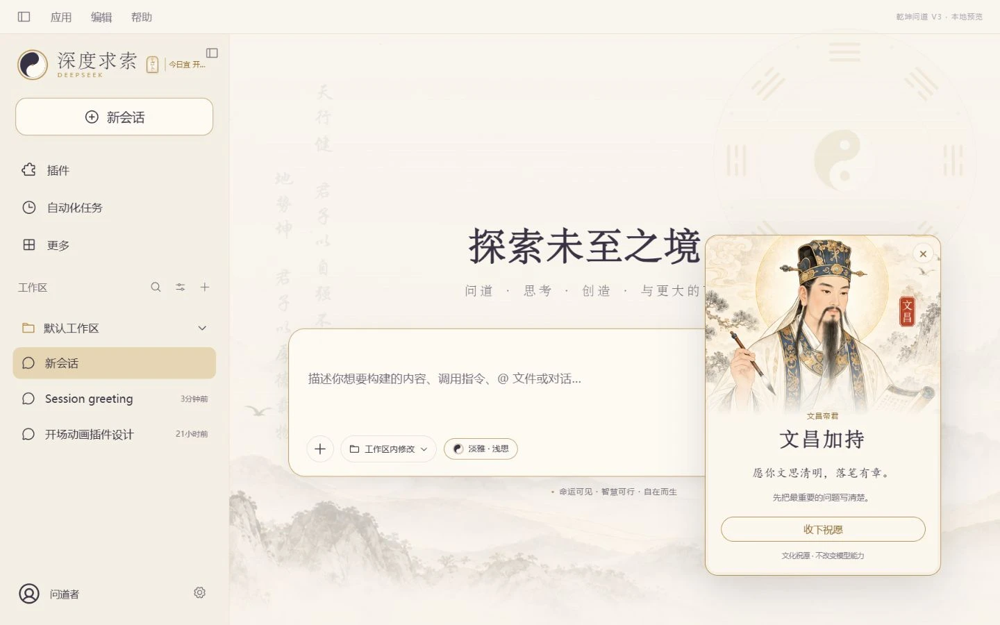

# 乾坤问道 V3.0 · 八位神明加持

V3 在原有主题上增加输入框右上的「加持」入口。首次点击从八位传统神明中随机一位，展开独立祝愿卡；「收下祝愿」后在入口旁保留今日徽记。再次打开或刷新不会重新抽取，按本地日期在次日更新。结果与收下状态保存在当前浏览器的本地存储中，不跨设备同步。

| 神明 | 主题 | 祝愿 |
| --- | --- | --- |
| 文昌帝君 | 文思清明 | 愿你文思清明，落笔有章。 |
| 关圣帝君 | 笃行有成 | 愿你心有定力，行有所成。 |
| 观音菩萨 | 安宁从容 | 愿你心境安宁，从容有序。 |
| 福德正神 | 日有所积 | 愿你脚下有根，日有所积。 |
| 太上老君 | 澄心静虑 | 愿你澄心静虑，知止有度。 |
| 玄天上帝 | 行稳致远 | 愿你心有定向，行稳致远。 |
| 天上圣母（妈祖） | 顺行平安 | 愿你一路平安，进退从容。 |
| 赵公明 | 勤耕有获 | 愿你勤有所获，积有所成。 |

## 使用与安装

从仓库 Releases 下载 `dsh-hermes-taiji-skin-3.0.0.zip`，解压后在 DSH 中安装内层 `package` 目录（该目录直接包含 `package.json`、`client.js` 和 `cordis.patch.yml`）。也可下载 npm 格式的 `.tgz`，或克隆仓库根目录安装。安装 ID 仍为 `@local/dsh-hermes-skin`。已有安装按 DSH 的插件更新流程更新同一目录；首次安装后退出并重新打开 DSH。

输入区的「淡雅 / 平衡 / 沉浸」设置中可以单独关闭「神明加持」；关闭「主题动效」或系统开启减少动态效果时，加持卡直接静态显示。卡片支持 Esc、点击外部、关闭按钮和 Tab 焦点循环；关闭后恢复到原入口。卡片在窄屏内滚动，不挡住关闭和收下操作。

保留 V2.0.1 的输入框高亮、侧栏选中态、今日宜、实际推理档位转动和敕令动效。加持仅为文化祝愿，不修改提示词、模型、推理参数或答案，不调用联网服务。

## 素材与组件

- `assets/deities/catalog.json`：八位神明的身份、主题、标题和祝愿。所有可操作文案均为真实前端文字。
- `assets/deities/*.webp`：八张 640 × 720 独立工笔画像；完整提示词和处理说明在 `assets/deities/GENERATION.md`。前四位沿用已认可的初稿，后四位由内置 image_gen 按同一宣纸、工笔、水墨和淡金风格生成。
- `src/blessings.mjs`：当日日期、随机选择和存储记录校验。
- `src/blessing-ui.js`、`src/blessing.css`：真实输入槽位锚点、浮层、今日徽记、持久化和无障碍交互。
- `scripts/build.mjs`：把画像与样式内嵌进独立 `client.js`，运行时无需图片服务器或 CDN。
- `preview/`：真实插件代码的仿 DSH 宿主。测试面板可指定神明、切换深色和长文布局；这些测试控制不打入插件。

开发运行 `npm ci`、`npm run build`、`npm test`、`npm run preview`。构建使用仓库中已准备好的 WebP。`npm run prepare:deities` 仅用于持有本地原始 PNG 的素材维护，不是安装或普通构建步骤。

## 验证与回退

13 项自动测试通过，覆盖八位素材、当日记录校验、重复打开、收下持久化、功能关闭、资源清理，以及原有真实推理联动。浏览器验证覆盖桌面、390px 窄屏、深色长文、折叠侧栏、焦点循环和刷新恢复；具体证据与范围见 `design-qa.md`。

当前验证使用真实插件与仿宿主；本次未安装到实际 DSH Desktop，实际宿主安装和模型调用需在用户环境确认。出现宿主兼容问题时先关闭「神明加持」或停用皮肤。上一版源码保留在提交 `db3dac6774a195b0d75bc93950a472ece687bb6b`；原初版发布 `v1.2.1` 保留，可重新下载并安装回退，不覆盖其历史发布。

## V3.1 · 神明落印与 108 签

- **落印动效**：在祝愿卡点「收下」后，除原有的徽记留存外，新增一层 2.6 秒落印动画：金光径向衬底 → 神像以 blur/scale 显圣 → 8 粒金尘自中心散开 → 题字「<神名>加持」浮现 → 朱印从卡面飞向「加持」入口并缩小消失。关闭主题动效或系统减少动态效果时整层不播。
- **神文按钮**：「加持」入口由「祈 + 加持」改为竖排「妈祖」二字（行楷，鎏金渐变流转 + 双金芒闪烁），每天随机神明后按钮保持常驻。
- **108 签**：每日卦象签池由 8 支扩充为六十四别卦（按八宫序排列）+ 四十四灵签，共 108 支；六爻图按「上卦（外）/下卦（内）」分别绘制，别卦的上卦由卦名自然物推断（如「天风姤」= 乾上巽下），纯卦上下同爻。
- **视觉微调**：选中项改为金色薄底 + 顶部回形圆角 + hover 加深；「今日宜」改双行居中版式；取消沉浸档星轮回影层（避免与主轮叠成重影）；右下今日卦象小签缩至更轻更小、悬停微展。

实现位置：`src/blessing-ui.js`（落印层与妈祖钮）、`src/blessing.css`（动效样式）、`src/client.js`（108 签签池与六爻上卦）、`src/qiankun.js`（卦象上下卦渲染）。「收下」后徽记状态仍写 `@local/dsh-hermes-skin/blessing-v3`，与之前一致。

## V3.1 · 紫微命盘

在八位神明加持之外，V3.1 内嵌紫微斗数开源排盘引擎（MIT，`vendor/ziwei/`，commit `495b79e`），并新增五处界面：

| 位置 | 槽位 | 组件 | 行为 |
| --- | --- | --- | --- |
| 模型选择器名字旁 | `conversation.input.model.label`（单槽，priority -100） | `ZiweiModelLabel` | 显示 `模型名 + [1017] + [紫微]`；1017 按官方公开口径复刻（provider ∈ {deepseek-official, deepseek-account}、model=deepseek-flash、目录名 `DeepSeek-V4.1-Flash`）；契约要求非交互，只做状态显示 |
| 输入区下沿 | `conversation.composer.dock`（order 22） | `ZiweiDockControls` | 「紫微推演」开关（按对话存 `hermes-ziwei-mode:s:<id>`）+「入盘」：把命盘档案 prepend 进草稿，重复入盘替换不叠加；无生辰时打开命盘并聚焦表单 |
| 输入区下沿 | `conversation.composer.dock`（order 23） | `ZiweiSendWatch` | 「发送自动带盘」开启时，回车前 capture 阶段补档案（只拦回车；发送按钮请用「入盘」） |
| 会话头右侧 | `conversation.session.header.utilities`（order 300） | `ZiweiHeaderButton` | 「斗 · 紫微命盘」打开本对话命盘 |
| 侧栏会话行悬停 | `sidebar.workspaces.session.row.action`（order 150） | `ZiweiSessionRowAction` | 「斗」按钮打开该会话命盘 |
| 全屏浮层 | `shell.overlay`（order 44） | `ZiweiPanel` | 880px 命盘对话框（见下） |

**命盘对话框**：出生表单（姓名/公历年月日时分/性别，实时排盘，钟点按 23 点归次日早子时）→ 传统 4×4 十二宫（命宫金框、身宫紫框、主星亮度小字、辅/吉/煞星、四化色标、空宫借对宫星、大限）→ 中心摘要（公历农历四柱、五行局、命主身主、命身宫、格局 chips）→「入盘 / 保存生辰 / 收起」。焦点管理与签卡一致（自动聚焦、Tab 卡内循环、Esc/背景/收起关闭后归还）；非法公历日期直接红条报错（引擎拒绝不存在的日期）。

**生辰存储**（只在本机浏览器，不跨设备）：

| 键 | 归属 | 生效 |
| --- | --- | --- |
| `hermes-ziwei-birth:s:<sessionId>` | 本对话 | 仅该会话 |
| `hermes-ziwei-birth:w:<workspaceId>` | 本工作区 | 该工作区会话的兜底 |
| `hermes-ziwei-birth:default` | 常用 | 全局兜底 |

解析链固定 **本对话 → 本工作区 → 常用**；工作区归属经宿主 `useWorkspaces` 快照解析（`items.find(w => w.sessionIds.includes(sessionId))`）。

**引擎与构建**：`vendor/ziwei/`（上游 `lib/ziwei/` 原样快照）+ `tools/build-engine.mjs`（esbuild + iztro/lunar-javascript → IIFE 919KB，显式挂 `window.__HermesZiwei__`）→ `scripts/build.mjs` 拼进 `client.js` 顶部。`npm run build` 会自动重建过期引擎；`node tools/test-engine.mjs` 跑金标准/确定性/非法日期/格局回归。上游断语库、AI 解读 API 与 13 维数据集未使用；排盘全在本机，零网络请求。

**边界**：`conversation.input.model.label` 是单槽位，接管会遮住官方 `ui-deepseek-model-label-1017`（已按公开口径复刻，停用皮肤即还原）；自动带盘只拦回车路径；命盘内容为传统排盘，仅供文化参考。

