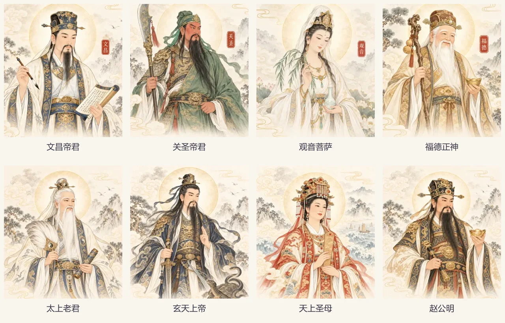
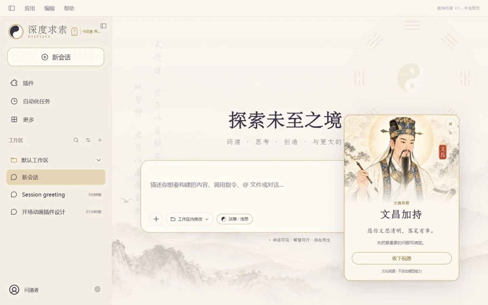

# 乾坤问道 V3.0 · 八位神明加持

V3 在原有主题上增加输入框右上的「加持」入口。首次点击从八位传统神明中随机一位，展开独立祝愿卡；「收下祝愿」后在入口旁保留今日徽记。再次打开或刷新不会重新抽取，按本地日期在次日更新。结果与收下状态保存在当前浏览器的本地存储中，不跨设备同步。

| 神明 | 主题 | 祝愿 |
| --- | --- | --- |
| 文昌帝君 | 文思清明 | 愿你文思清明，落笔有章。 |
| 关圣帝君 | 笃行有成 | 愿你心有定力，行有所成。 |
| 观音菩萨 | 安宁从容 | 愿你心境安宁，从容有序。 |
| 福德正神 | 日有所积 | 愿你脚下有根，日有所积。 |
| 太上老君 | 澄心静虑 | 愿你澄心静虑，知止有度。 |
| 玄天上帝 | 行稳致远 | 愿你心有定向，行稳致远。 |
| 天上圣母（妈祖） | 顺行平安 | 愿你一路平安，进退从容。 |
| 赵公明 | 勤耕有获 | 愿你勤有所获，积有所成。 |

## 使用与安装

从仓库 Releases 下载 `dsh-hermes-taiji-skin-3.0.0.zip`，解压后在 DSH 中安装内层 `package` 目录（该目录直接包含 `package.json`、`client.js` 和 `cordis.patch.yml`）。也可下载 npm 格式的 `.tgz`，或克隆仓库根目录安装。安装 ID 仍为 `@local/dsh-hermes-skin`。已有安装按 DSH 的插件更新流程更新同一目录；首次安装后退出并重新打开 DSH。

输入区的「淡雅 / 平衡 / 沉浸」设置中可以单独关闭「神明加持」；关闭「主题动效」或系统开启减少动态效果时，加持卡直接静态显示。卡片支持 Esc、点击外部、关闭按钮和 Tab 焦点循环；关闭后恢复到原入口。卡片在窄屏内滚动，不挡住关闭和收下操作。

保留 V2.0.1 的输入框高亮、侧栏选中态、今日宜、实际推理档位转动和敕令动效。加持仅为文化祝愿，不修改提示词、模型、推理参数或答案，不调用联网服务。

## 素材与组件

- `assets/deities/catalog.json`：八位神明的身份、主题、标题和祝愿。所有可操作文案均为真实前端文字。
- `assets/deities/*.webp`：八张 640 × 720 独立工笔画像；完整提示词和处理说明在 `assets/deities/GENERATION.md`。前四位沿用已认可的初稿，后四位由内置 image_gen 按同一宣纸、工笔、水墨和淡金风格生成。
- `src/blessings.mjs`：当日日期、随机选择和存储记录校验。
- `src/blessing-ui.js`、`src/blessing.css`：真实输入槽位锚点、浮层、今日徽记、持久化和无障碍交互。
- `scripts/build.mjs`：把画像与样式内嵌进独立 `client.js`，运行时无需图片服务器或 CDN。
- `preview/`：真实插件代码的仿 DSH 宿主。测试面板可指定神明、切换深色和长文布局；这些测试控制不打入插件。

开发运行 `npm ci`、`npm run build`、`npm test`、`npm run preview`。构建使用仓库中已准备好的 WebP。`npm run prepare:deities` 仅用于持有本地原始 PNG 的素材维护，不是安装或普通构建步骤。

## 验证与回退

13 项自动测试通过，覆盖八位素材、当日记录校验、重复打开、收下持久化、功能关闭、资源清理，以及原有真实推理联动。浏览器验证覆盖桌面、390px 窄屏、深色长文、折叠侧栏、焦点循环和刷新恢复；具体证据与范围见 `design-qa.md`。

当前验证使用真实插件与仿宿主；本次未安装到实际 DSH Desktop，实际宿主安装和模型调用需在用户环境确认。出现宿主兼容问题时先关闭「神明加持」或停用皮肤。上一版源码保留在提交 `db3dac6774a195b0d75bc93950a472ece687bb6b`；原初版发布 `v1.2.1` 保留，可重新下载并安装回退，不覆盖其历史发布。
